<div align="center">

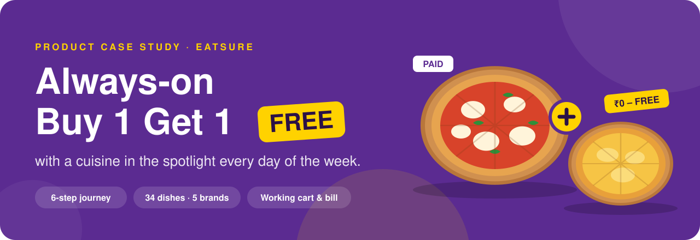

<br/>


**[The brief](#01--the-brief)** ·
**[The idea](#02--the-idea)** ·
**[The journey](#03--the-journey)** ·
**[Decisions](#04--design-decisions)** ·
**[What to measure](#05--what-to-measure)** ·
**[Where it stands](#06--where-it-stands)** ·
**[Run it](#08--run-it-yourself)**

</div>

---

> **An unofficial concept.** I made this as a product case study for an EatSure interview. It is not affiliated with EatSure or Rebel Foods. Brand names are used for realism; dishes, prices and ratings are illustrative, and the prototype never places a real order.

---

## 01 · The brief

Design a mobile-first, end-to-end journey for an **always-on Buy 1 Get 1 Free** programme inside the EatSure app, in EatSure's own purple (`#5B2B91`), yellow (`#FFD200`) and white. Six screens: home entry points, a BOGO Zone, the add-to-cart moment, cart review, checkout and a post-order celebration. The original brief is in [`docs/brief.md`](docs/brief.md).

The interesting part of the brief is the add-to-cart moment. A BOGO offer only works if people actually claim the free dish, so the journey has to make picking it feel obvious, quick and rewarding, without blocking anyone who just wants to keep browsing.

## 02 · The idea

**BOGO is always on, and every day has a spotlight.** Every brand runs Buy 1 Get 1 all week. On top of that, one cuisine gets the spotlight each day. It gives people a reason to open the app on a particular day without ever switching the core offer off.

| Sun | Mon | Tue | Wed | Thu | Fri | Sat |
|---|---|---|---|---|---|---|
| Family Combo Sunday | Biryani Monday | Roll Tuesday | Burger Wednesday | Dessert Thursday | Pizza Friday | **Italian BOGO Day** |

**The rule is one sentence:** buy any BOGO dish and get one more from the **same brand** that costs the **same or less**, for ₹0. Order two, get two. There's no minimum order and no code to type.

Keeping the free dish inside the same brand keeps the order to one kitchen and one delivery. The equal-or-lower price cap is there to protect the margin on the paid dish.

## 03 · The journey

<div align="center">
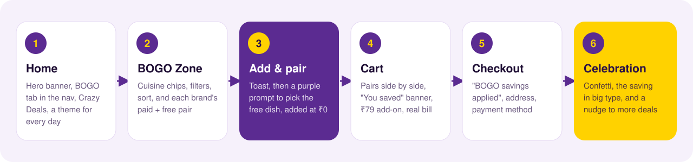
</div>

<table>
<tr>
<td width="33%">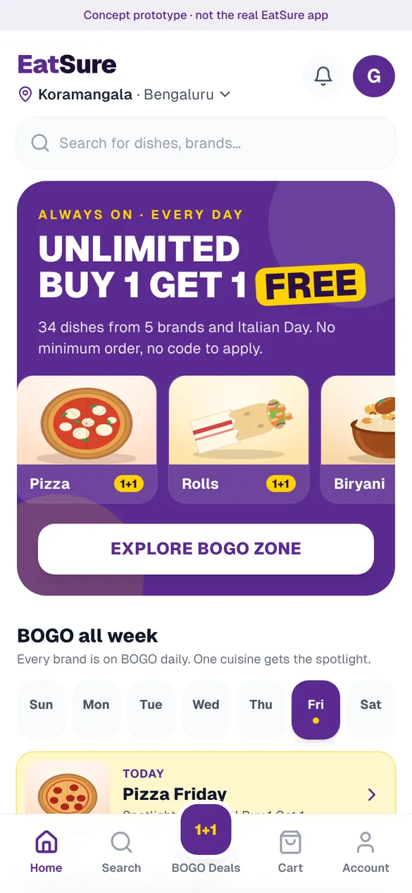<br/><sub><b>1 · Home.</b> The hero from the brief, cuisine cards, and the old Multi-Resto tab replaced by a purple and yellow <b>1+1</b> BOGO tab.</sub></td>
<td width="33%">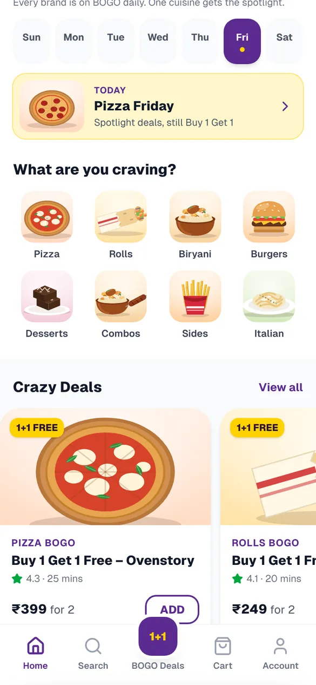<br/><sub><b>1 · BOGO all week.</b> Today is picked automatically. Tapping a day opens its spotlight.</sub></td>
<td width="33%">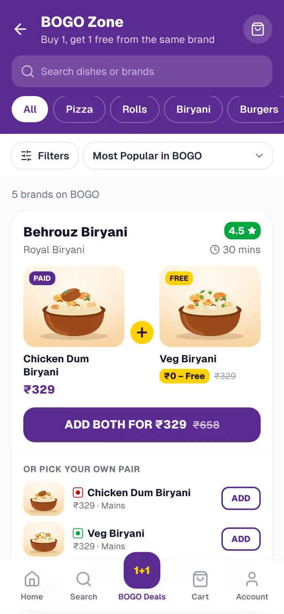<br/><sub><b>2 · BOGO Zone.</b> Chips, filters and sort, and each brand's paid + free pair with the ₹0 tag and the struck-out price.</sub></td>
</tr>
<tr>
<td width="33%">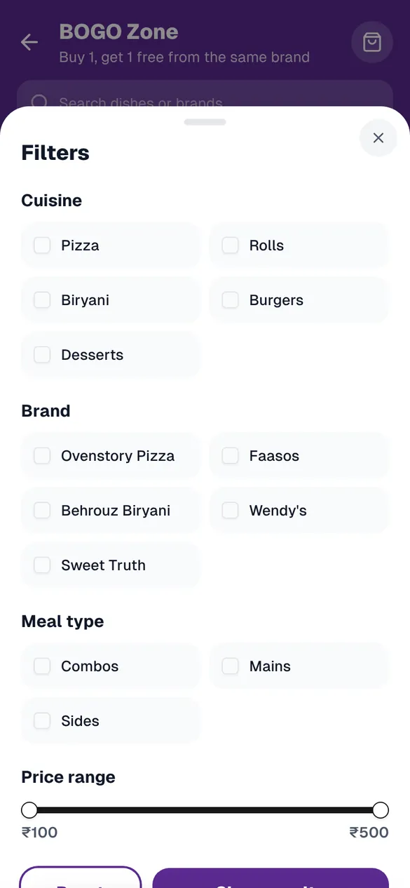<br/><sub><b>2 · Filters.</b> Cuisine, brand, meal type and price range, all working.</sub></td>
<td width="33%">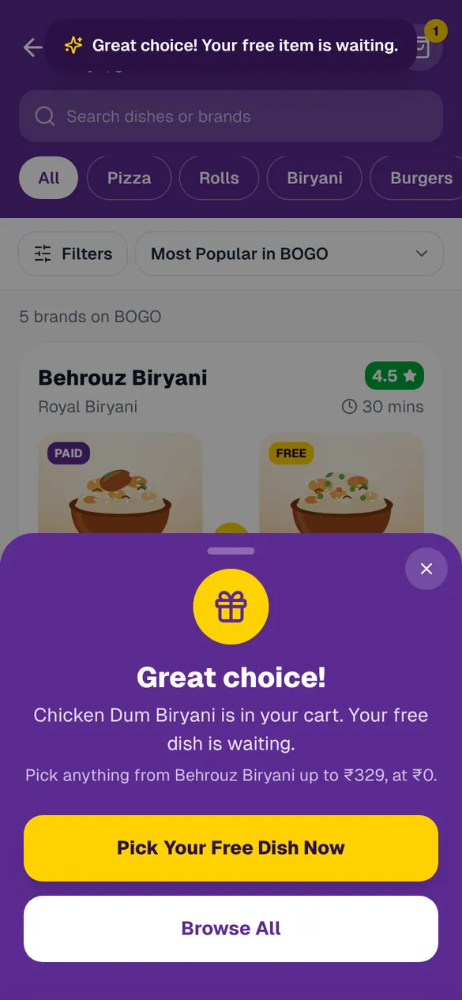<br/><sub><b>3 · Add & pair.</b> The toast, then the purple prompt with the yellow "Pick Your Free Dish Now" and a white "Browse All" way out.</sub></td>
<td width="33%">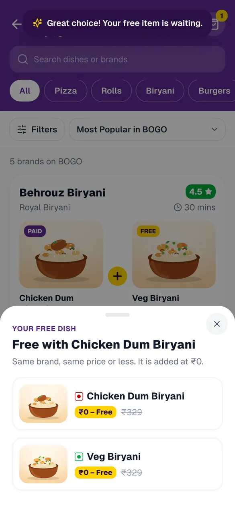<br/><sub><b>3 · Pick the free dish.</b> Only dishes that qualify, each tagged ₹0 – Free.</sub></td>
</tr>
<tr>
<td width="33%">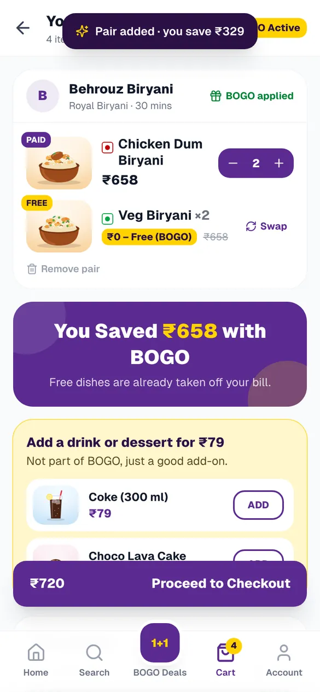<br/><sub><b>4 · Cart.</b> Each pair side by side, a "You Saved ₹X with BOGO" banner and a ₹79 drink or dessert.</sub></td>
<td width="33%">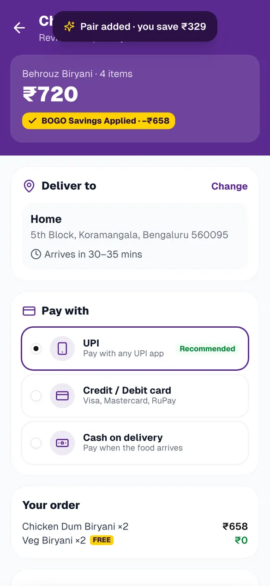<br/><sub><b>5 · Checkout.</b> "BOGO Savings Applied" up top, address, payment and the bill.</sub></td>
<td width="33%">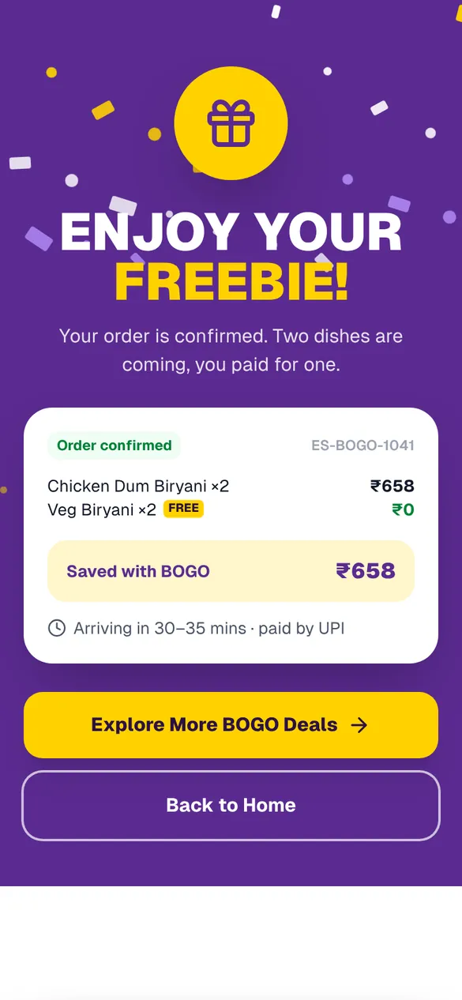<br/><sub><b>6 · Celebration.</b> Purple and yellow confetti, the saving, and a way back to more deals.</sub></td>
</tr>
</table>

<div align="center">
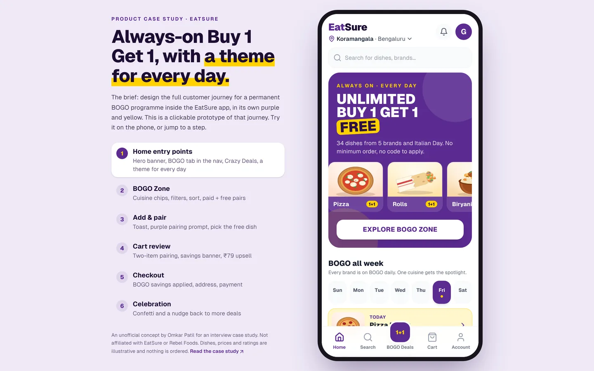
<br/><sub>On a laptop the app sits in a phone frame, next to a panel that explains the brief and jumps to any step. That makes it easy to demo in an interview.</sub>
</div>

<details>
<summary><b>Italian BOGO Day and the account screen</b></summary>
<br/>
<table>
<tr>
<td width="50%">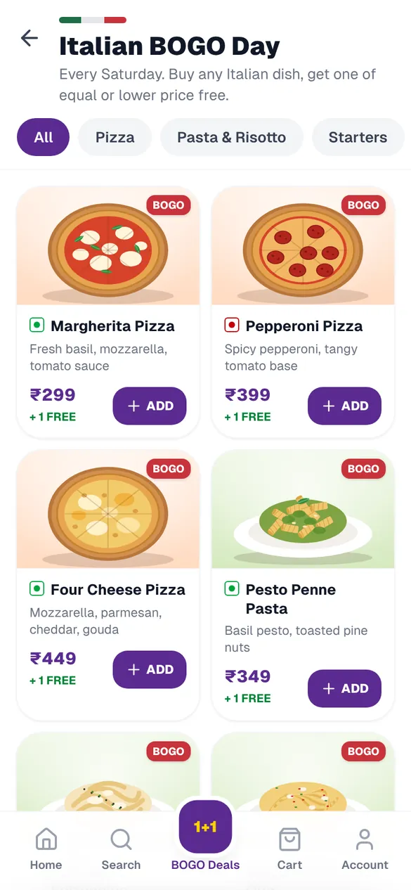<br/><sub><b>Italian BOGO Day.</b> 15 dishes in four tabs.</sub></td>
<td width="50%">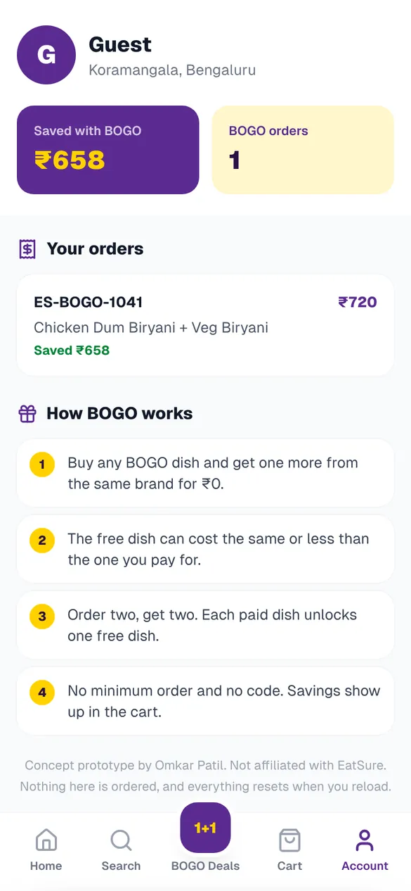<br/><sub><b>Account.</b> Savings so far, past orders and the BOGO rules in four lines.</sub></td>
</tr>
</table>
</details>

## 04 · Design decisions

| Decision | Why |
|---|---|
| **Show the pair, not just a badge.** Paid dish and free dish sit side by side, with the free one tagged "₹0 – Free" and its price struck out. | "Buy 1 Get 1" is abstract. Two dishes and a crossed-out ₹399 make the value concrete. |
| **Two ways to add.** "Add both" for the suggested pair, or add any dish and choose the free one yourself. | A fast path for most people, and choice for the people who care. |
| **Nudge, don't block.** After the first add, a toast and a pairing prompt appear, but "Browse All" closes it. | Forcing the choice would interrupt people mid-browse. Instead the cart keeps a dashed "Pick your free dish" slot, and the checkout button becomes "Pick your free dish first" until it's done. |
| **Same brand, same price or less.** | One kitchen, one delivery, and the free dish can never be worth more than the paid one. |
| **Repeat the saving.** It appears in the cart, at checkout, on the celebration screen and in the account. | People remember the deal that felt good. The saving is the story, so the journey tells it four times. |
| **A tab, not a banner.** BOGO replaces the Multi-Resto tab in the bottom nav. | A permanent offer needs a permanent home, not a carousel slot. |
| **Upsell outside BOGO.** A ₹79 drink or dessert in the cart. | Lifts order value without touching the BOGO rule. |
| **Readable yellow.** Yellow is only used as a background behind dark text, never as text on white. | `#FFD200` text on white fails contrast badly. |

## 05 · What to measure

These are the metrics I'd propose for a pilot. They are a plan, not results; this prototype has no users.

| Question | Metric |
|---|---|
| Do people claim the free dish? | Share of BOGO orders where the free dish is picked, and drop-off at the pairing prompt |
| Does BOGO grow orders or just discount them? | Order frequency and 30-day repeat rate for BOGO users vs. a holdout; full-price orders cannibalised |
| Is it worth it? | Contribution margin per BOGO order vs. non-BOGO; average order value |
| Do day themes move demand? | Orders by day of week for the spotlight cuisine, before and after |
| Does the upsell work? | Attach rate of the ₹79 add-on |
| Guardrails | Delivery time and ratings for BOGO orders, since two dishes per order loads the kitchen |

## 06 · Where it stands

|  |  |
|---|---|
| **Status** | Clickable prototype of the whole journey. |
| **Data** | Brands, dishes, prices and day themes live in [`lib/bogo-data.ts`](lib/bogo-data.ts). The cart and the bill are real calculations in [`lib/cart.ts`](lib/cart.ts): item total, BOGO savings, add-ons, ₹29 delivery and 5% GST. |
| **Images** | Every dish is an SVG illustration drawn in code ([`dish-art.tsx`](app/components/dish-art.tsx)). The first version, generated with v0 in 2025, pointed at photo files that were never committed to this repo, so every image in it was broken. |
| **Checks** | Strict TypeScript and a production build. No automated tests. |
| **History** | First built for the interview in August 2025. Reworked in October 2026: real cart state, working filters, sort and search, the day-wise themes, illustrations, and the desktop frame. |

## 07 · What it is not

- **Not the EatSure app**, and not connected to anything. No menus, no payments, no orders.
- **Not tested with users.** The design decisions above are reasoning, not findings.
- **Prices, ratings and delivery times are made up**, and the brand line-up is illustrative.
- **Day themes are a concept.** In the prototype you can open Italian BOGO Day on any day.
- **Nothing is saved.** Reloading the page resets the cart and orders.

## 08 · Run it yourself

You'll need Node 20+ and pnpm.

```bash
git clone https://github.com/omkarpatilswork/Eatsure-Day-wise-BOGO-.git
cd Eatsure-Day-wise-BOGO-
pnpm install
pnpm dev            # http://localhost:3000
```

```bash
pnpm build          # type-checks and builds for production
```

## Repository map

```
Eatsure-Day-wise-BOGO-/
├── app/
│   ├── page.tsx               screen routing, cart state, phone frame
│   └── components/
│       ├── home-page.tsx      step 1: hero, day themes, Crazy Deals
│       ├── bogo-zone.tsx      step 2: chips, filters, sort, pairs
│       ├── bogo-sheets.tsx    step 3: pairing prompt and free-dish picker
│       ├── cart-page.tsx      step 4: pairs, savings, add-ons, bill
│       ├── checkout-page.tsx  step 5
│       ├── celebration-page.tsx  step 6
│       ├── italian-bogo-day.tsx, search-page.tsx, profile-page.tsx
│       ├── dish-art.tsx       33 SVG dish illustrations
│       └── case-study-panel.tsx  the desktop side panel
├── lib/
│   ├── bogo-data.ts           brands, dishes, rule, day themes
│   └── cart.ts                cart reducer and bill maths
└── docs/                      brief, screenshots, diagrams
```

---

<div align="center">
<sub>A case study by <a href="https://www.omkarpatil.in">Omkar Patil</a> · Not affiliated with EatSure or Rebel Foods</sub>
</div>
